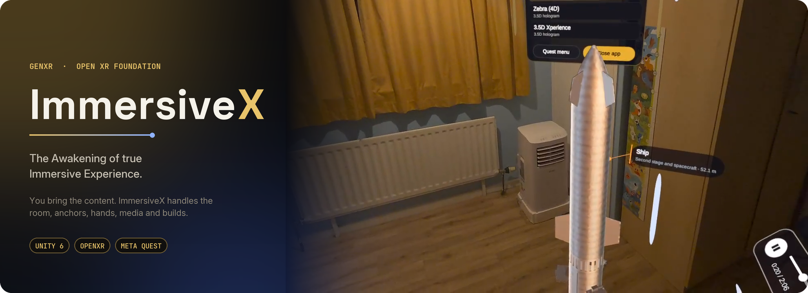
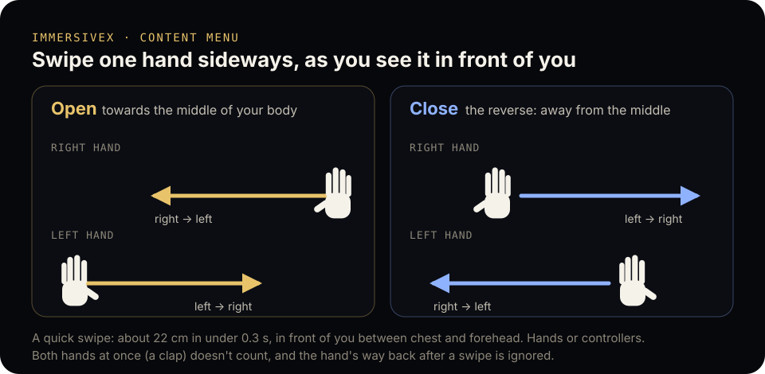
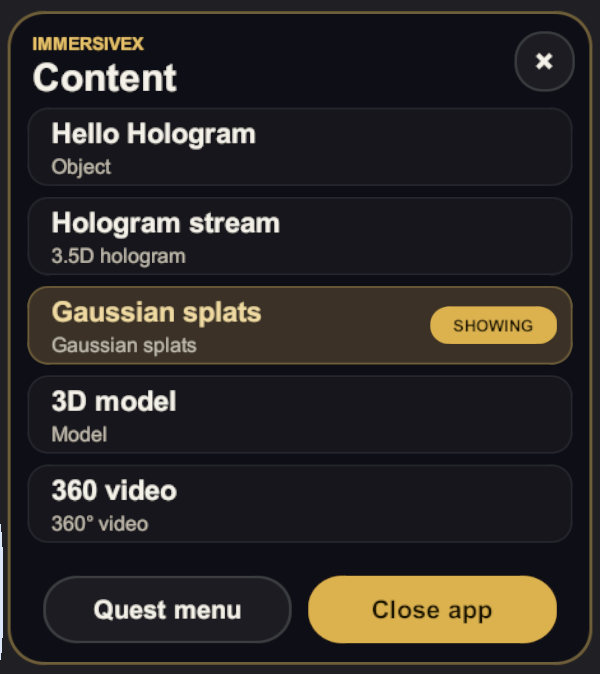

# ImmersiveX

**The Awakening of true Immersive Experience.**



ImmersiveX is an open Unity foundation for mixed, augmented and virtual reality apps.
You bring the content. ImmersiveX handles the rest:
- the see-through view
- room mapping
- saved placement
- hand and controller interaction
- media playback and controls
- physics
- the build setup for each headset

All of it runs from one codebase.

> **Status: pre-alpha, running on Meta Quest 3.**
> - **Done and checked on a Quest 3:**
>   - M0 (foundation) and M1 ("Hello Hologram"): passthrough, no boundary, Space Setup, grabbing with hands and controllers.
>   - Rooms mapped through Space Setup and saved automatically.
>   - Content placed in front of you at launch and on each pick, then held in place by spatial anchors through headset off/on.
>   - Immersive media (streamed holograms, 4D Gaussian splats and 4D meshes, with their sound) and the content menu.
> - **In progress:**
>   - The last device checks of M2 (room mapping) and M3 (anchors).
>   - Device checks for the other content types, which are so far verified in the editor and the Meta XR Simulator.
>
> See [Roadmap](#roadmap).

## What you get

| | Functionality | Default behaviour | Status |
|---|---|---|---|
| F1 | See-through view | Mixed/augmented reality on every device except VR-only headsets | Working on Quest |
| F2 | Automatic room mapping | Known rooms load with no prompt; a new room is mapped (Quest Space Setup, or a guided 360° look-around and floor pass) and saved; no boundary drawing | Working on Quest |
| F3 | Anchors | Content starts in front of you on the floor you're on, then stays where you leave it through the headset coming off | Working on Quest |
| F4 | Hands and controllers | A controller's ray clicks and drags handles; a hand or controller at the content picks it up | Working on Quest |
| F5 | Motion restrictions | Allow rotation around any combination of X, Y and Z per object | Planned (M4) |
| F6 | Immersive media | One component plays any supported format (below), with the same controls and handles for all | Working; device checks ongoing |
| F7 | Gravity | Objects can fall and rest on the real floor and furniture | Planned (M4) |
| F8 | Transparency | Every object is transparent by default (opacity 0.5), overridable per object | Planned (M4) |
| F9 | Platform adapters | One contract per device, each with a build guide | Meta Quest done |
| F10 | Pinned versions | Exact, tested SDK versions per platform, installed with its adapter | Meta Quest done |

### Content it plays, with no code
Add content with **ImmersiveX ▸ Media ▸ Add Media…** (a file, a folder or a URL). It becomes an **Immersive Media** object in the scene, and the build checks that everything it needs ships with the app.

| Content | Formats |
|---|---|
| Gaussian splats | `.ply` (3DGS and compressed), `.spz`, `.splat`, `.ksplat` |
| 4D Gaussian splats | a folder of splat frames, packed for the headset, with an optional soundtrack |
| Hologram streams | `stream.json` + frames, from a URL or bundled |
| Point clouds | `.ply` with points |
| Frame sequences | numbered mesh, point or splat frames, or a `sequence.json` |
| 3D models | glTF / GLB, with animation, Draco, KTX2 and meshopt |
| Meshes | OBJ (+ MTL and textures), PLY, STL |
| Video | MP4 / MOV (H.264, H.265), WebM (VP8); flat, 180° or 360°, mono or stereo |
| Photos | JPG, PNG; flat, 180° or 360° |
| Web experiences | three.js pages: the page runs out of sight, its 3D scene is drawn natively in the room, and its own controls sit on a panel beside it |
| 4D meshes | `.sp4m`: a scene baked over time (moving parts, baked colours, soft effects), with captions and cards that point at its parts |

[CONTENT_GUIDE.md](CONTENT_GUIDE.md) gives the structure each kind needs and what isn't supported yet; [docs/media.md](docs/media.md) covers the component.

### Your own app, with ImmersiveX as its host
**Bare metal content** is an app that owns everything: its menus, its layout, what it shows. ImmersiveX only connects it to the headset: permissions, the see-through view, no boundary, hands and controllers. It also gives the app the headset's camera (Quest 3 and 3S), ray casts against the real world, spatial anchors and the room. Nothing ties the app to a mapped room, so the user can walk anywhere. Start one with **ImmersiveX ▸ New Bare Metal Scene**; [docs/bare-metal.md](docs/bare-metal.md) covers the host.

### In the headset
- **Controls:** every piece of content gets play/pause, seek, time and sound controls, plus handles to move, turn (bars and a ring) and resize it.
- **Parts:** models, web scenes and 4D meshes have selectable parts. A ray click selects a part, a hand picks it up, and **Put back** returns it.
- **Content menu:** every piece of content in the scene, one shown at a time (the choice is remembered), plus **Quest menu** and **Close app**, and **MR / VR** buttons in its header: MR shows your room, VR puts the content in a dim virtual world (your real walls and furniture glow faintly when you come close). It opens in front of you when the app starts; with more than six pieces it scrolls with the up and down buttons beside the list. **Space** shows whether your room is saved and can re-create it. Open and close it with a quick sideways swipe of either hand (or controller):
  - **Open:** swipe towards the middle of your body: the right hand from right to left, or the left hand from left to right.
  - **Close:** the reverse: the right hand from left to right, or the left hand from right to left.
  - A swipe is about 22 cm in under 0.3 s, in front of you between chest and forehead. Both hands at once (a clap) doesn't count, and the hand's way back after a swipe is ignored. Swiping again while the menu is elsewhere brings it to you.

<p align="center"></p>
<p align="center"></p>

## Platforms

| Wave | Platforms | Status |
|---|---|---|
| 1 | Meta Quest 3 / 3S, Quest Pro / 2 | Working (preview), verified on Quest 3; builds meet the Meta Horizon Store's release manifest rules |
| 2 | Apple Vision Pro, iPhone / iPad (ARKit), Android phones (ARCore), Android XR | Planned |
| 3 | HoloLens 2, Magic Leap 2, PC VR via SteamVR, HTC VIVE | Planned |
| 4 | PlayStation VR2 (native PS5) | Stub only — needs a Sony licence ([ADR-0008](docs/adr/0008-nda-platforms-as-stubs.md)) |

## Get started

### Requirements
- **Unity 6000.3.23f1**, installed through Unity Hub.
- For Meta Quest, add the **Android Build Support** module, including **Android SDK & NDK Tools** and **OpenJDK**.
- Git.

### Open the project
1. Clone the repository:
   ```sh
   git clone https://github.com/OlafenwaMoses/ImmersiveX.git
   ```
2. In Unity Hub, choose **Add ▸ Add project from disk** and select the cloned `ImmersiveX` folder.
3. Open it with Unity 6000.3.23f1. The first import downloads the pinned packages and takes a few minutes.

The project opens with URP configured for XR, linear colour and the Input System.
If settings ever drift, run **ImmersiveX ▸ Maintenance ▸ Apply Project Baseline**.

### Build your first experience
1. **ImmersiveX ▸ Platform Setup ▸ Meta Quest ▸ Install**, then **Configure**.
2. Add content:
   - **Media** (splats, 4D captures, models, video, photos, web pages, 4D meshes): **ImmersiveX ▸ Media ▸ Add Media…**, then save the scene.
   - **Your own Unity objects:** put them in `Assets/Content/`, drag them into `Assets/Scenes/Main.unity`, then right-click each one ▸ **ImmersiveX ▸ Make Immersive**. (New scenes: **ImmersiveX ▸ New Scene**.)
   - **Your own app, with ImmersiveX only as its host:** **ImmersiveX ▸ New Bare Metal Scene**, then put your code on its app object ([bare metal content](docs/bare-metal.md)).
   - **Where it stands and how it plays** (order in the menu, Placement, Height, Up, Play On Start): see [Placing content in the app](CONTENT_GUIDE.md#placing-content-in-the-app). Web experiences are best added by an AI coding agent that tests them in the simulator ([section 12](CONTENT_GUIDE.md#adding-a-web-experience-with-an-ai-coding-agent-recommended)).
3. Try it without a headset:
   - **ImmersiveX ▸ Play Mode ▸ Meta XR Simulator (Quest)** or **XR Simulation (any device)**
   - then press **Play**.
4. Connect the headset, then **Platform Setup ▸ Build And Run**.

Bundled content lives in `Assets/StreamingAssets/ImmersiveXContent/`, which is git-ignored because of its size. After a fresh clone, add your content again; **ImmersiveX ▸ Media ▸ Check Content in the Build** (and every build) says what's missing.

The [Meta Quest guide](docs/platforms/meta-quest.md) covers requirements, the simulator and troubleshooting.

### Publishing to the Meta Horizon Store
Quest builds already follow Meta's release manifest rules:
- minSdk 32 and targetSdk 34;
- install location `auto`;
- a landscape launch activity, excluded from recents;
- Meta's device identifiers and default device targets (Quest 2 and later);
- app data not backed up (`android:allowBackup="false"`), as the store's security review asks;
- not debuggable.

What you add:
1. Sign the APK with your own release key, v1 and v2 signatures (`apksigner`). Keep the key safe: every store update must be signed with it.
2. Raise **Bundle Version Code** for each upload.
3. Upload it with Meta Quest Developer Hub.

## Repository layout

```
ImmersiveX/                     ← open this folder in Unity Hub
├─ Assets/
│  ├─ Content/                  your experiences
│  ├─ Demos/                    demo scenes (ImmersiveX ▸ Demos)
│  ├─ Scenes/                   the starter scene
│  └─ Settings/Rendering/       URP assets
├─ Packages/
│  ├─ manifest.json
│  ├─ com.immersivex.core/      shared, platform-agnostic core: session, rooms, anchors, interaction, parts, content menu
│  └─ com.immersivex.media/     Immersive Media: format detection, players, controls, Add Media, the build check
├─ Platforms/                   one opt-in adapter package per device (MetaQuest, _Template)
├─ ProjectSettings/
├─ docs/                        decisions (adr/), spike findings (spikes/), media, platform guides
├─ tools/                       CI checks (ci/) and test media samples (samples/)
├─ CONTENT_GUIDE.md             every content type and the structure it needs
└─ .github/                     CI workflow and issue/PR templates
```

## How it's built
- **One shared core, one seam.** `com.immersivex.core` depends only on AR Foundation, XR Interaction Toolkit and XR Hands. It reaches devices through a single platform contract ([ADR-0002](docs/adr/0002-core-on-unity-xr-stack.md)).
- **Media is its own package.** `com.immersivex.media` builds on the core and keeps format libraries (such as glTFast) out of it.
- **Thin, opt-in adapters.** Each platform is a package that pins its own SDK versions ([ADR-0003](docs/adr/0003-opt-in-platform-adapter-packages.md)).
- **Degrade, never crash.** Features choose a strategy from what the device can do and fall back when it can't ([ADR-0005](docs/adr/0005-capability-driven-fallbacks.md)).
- **Private by default.** Room data stays on the device, and placements use the platform's own anchor store ([ADR-0006](docs/adr/0006-local-first-system-anchors.md)).
- **Rules, not special cases.** Every feature works the same way for all content of its kind.
- **Tested.** 141 EditMode tests cover the core, the media formats and the content pipeline.

All decisions are in [`docs/adr/`](docs/adr/README.md). Findings from the investigation spikes are in [`docs/spikes/`](docs/spikes/README.md).

## Roadmap

| Milestone | Goal | Status |
|---|---|---|
| **M0** | Foundation: project, pinned packages, decisions, Quest spikes, CI | ✅ Done |
| **M1** | Core skeleton + "Hello Hologram" on Quest (see-through, hands and controllers) | ✅ Done |
| **M2** | Automatic room mapping and saved rooms | Working on Quest; last device checks left |
| **M3** | Persistent content anchors | Working on Quest; nearest-wall placement left |
| Media | Immersive Media: every format above, many at once, the content menu, selectable parts, web experiences, 4D splats and 4D meshes | Working; device checks for some formats left |
| M4 | Motion restrictions, gravity, transparency | Planned |
| M5 | Media dashboard on any object, with download-and-cache for offline play | Planned (playback controls already ship with Immersive Media) |
| M6 | Platform Setup v2, samples, docs and release tooling | Started: Meta Horizon Store packaging |
| M7 | Wave 2: visionOS, ARKit, ARCore, Android XR | Planned |
| M8 | Wave 3: SteamVR, VIVE, Magic Leap 2, HoloLens 2, PS VR2 stub | Planned |
| M9 | 1.0 release | Planned |

## Contributing
Contributions are welcome. Start with [CONTRIBUTING.md](CONTRIBUTING.md). Everyone is expected to follow the [Code of Conduct](CODE_OF_CONDUCT.md).
Please report security issues privately, as described in [SECURITY.md](SECURITY.md).

## License
[MIT](LICENSE) © 2026 Moses Olafenwa
